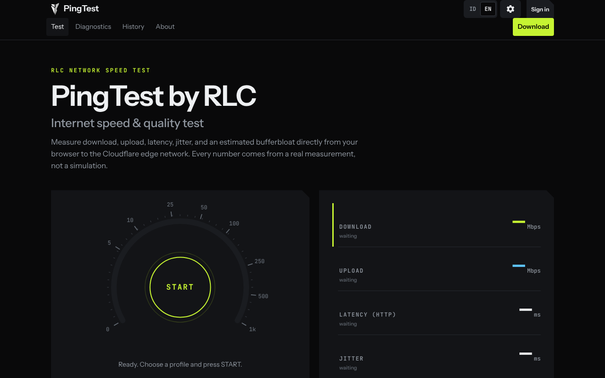
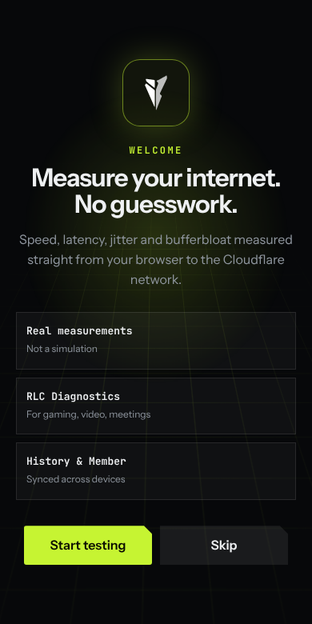
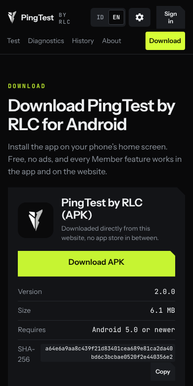

  
  

  
  
  
  
  
  
  
  
  
  

Lencana di atas hanyalah elemen dekoratif gaya RLC. Ini <b>bukan</b> penghargaan resmi dari GitHub maupun pihak mana pun.

---

## Tentang

**PingTest by RLC** adalah website tes kecepatan dan kualitas internet: download, upload, latency, jitter, dan estimasi bufferbloat, diukur langsung dari browser ke jaringan Cloudflare memakai mesin resmi [`@cloudflare/speedtest`](https://github.com/cloudflare/speedtest) (MIT). Setiap angka berasal dari pengukuran nyata, bukan simulasi.

Dikembangkan oleh **Rogue Logic Creations (RLC)** dari ide **Farid Alfiyansah**, siswa TJKT SMK Tamtama Karanganyar.

## Tampilan

  
  
  

## Fitur

| | |
|---|---|
| **Tes nyata** | Download, upload, latency, jitter, estimasi bufferbloat; profil *Hemat data* dan *Standar*. |
| **Diagnostik RLC** | Kelayakan streaming, video call, game, dan cloud, lengkap dengan saran dan perbandingan dengan tes sebelumnya. |
| **Riwayat** | Tersimpan di perangkat (Guest) atau di akun (Member); ekspor CSV/JSON dan bagikan sebagai gambar. |
| **Akun Member** | Supabase Auth + RLS: setiap akun hanya bisa membaca datanya sendiri. Pengaturan tersinkron lintas perangkat. |
| **Landing pertama** | Ditampilkan sekali per akun (lintas perangkat); Guest sekali per perangkat. |
| **Download APK** | Popup gaya notifikasi iOS dan halaman `/download` mengunduh APK langsung dari website, lengkap dengan SHA-256 yang dihitung saat build. |
| **Dwibahasa & tema** | Indonesia / English, Gelap / Terang / Sistem, mode Glass dan animasi. |
| **PWA** | Dapat dipasang dari Chrome; service worker hanya menyimpan berkas statis publik. |
| **Privasi** | Tanpa cookie pelacak dan tanpa analytics. |

## Teknologi

Vite 8 (multi-page) · JavaScript murni · `@cloudflare/speedtest` · Supabase (Auth + Postgres) · Vercel · Service Worker.

## Developer

**Farid Alfiyansah** — [@r1dzzz](https://github.com/r1dzzz) · Rogue Logic Creations (RLC) · SMK Tamtama Karanganyar, TJKT.

## Lisensi

Kode situs: lihat [LICENSE](LICENSE). `@cloudflare/speedtest` berlisensi MIT. Nama dan logo Claude, ChatGPT, Grok, Kimi, serta logo sekolah dan LPKS X Japan adalah milik masing-masing pemiliknya dan hanya dipakai untuk identifikasi.

Dibuat dengan ⚡ oleh RLC

